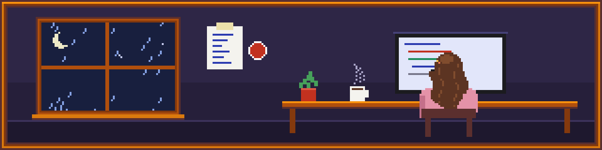

  

# Olá, eu sou a Isa!

<table align="center">
  <tr>
    <td width="200px" align="center">
      
       
      <b>Desenvolvedora Junior</b>
    </td>
    <td width="400px" valign="top">
      <h3>Sobre mim</h3>
      
Desenvolvedora júnior e estudante de Engenharia de Software. Trabalho com back-end, front-end e automações, e no tempo livre faço parte da equipe de robótica da faculdade.

      

    </td>
  </tr>
</table>

### Inventário

| <kbd>1</kbd> | <kbd>2</kbd> | <kbd>3</kbd> | <kbd>4</kbd> | <kbd>5</kbd> | <kbd>6</kbd> | <kbd>7</kbd> | <kbd>8</kbd> | <kbd>9</kbd> | <kbd>0</kbd> | <kbd>-</kbd> | <kbd>=</kbd> |
| :---: | :---: | :---: | :---: | :---: | :---: | :---: | :---: | :---: | :---: | :---: | :---: |
|  Python |  FastAPI |  Django |  Vue |  Docker |  Git |  GitHub |  C |  C# |  Arduino |  Linux | vazio |

Também uso **n8n** pra automações e **EasyPanel** pra deploy.

### Estatísticas

  
  

  

### Gostos

| Gosto | Não curto |
| :--- | :--- |
| Café forte | Café descafeinado |
| Clarice Lispector | Bugs em produção |
| Colagem e adesivos | Código sem documentação |
| Noites chuvosas | |

### Contato

[LinkedIn](https://www.linkedin.com/in/isabelle-cunha-3b085a29a/) · [E-mail](mailto:isabelledccunha@gmail.com)